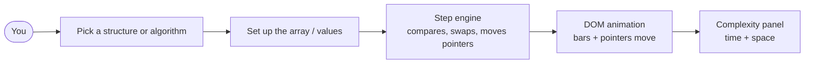

# 🚀 DSA Visualizer

[](https://pawanriko.github.io/DSA-Visualizer/)


[](https://skillicons.dev)

An interactive web-based Data Structures and Algorithms Visualizer built using HTML, CSS, and JavaScript.

This project helps students understand how common data structures and algorithms work through real-time visual animations, complexity analysis, and interactive controls.

**Live:** [pawanriko.github.io/DSA-Visualizer/](https://pawanriko.github.io/DSA-Visualizer/)

## How it works


---

## ✨ Features

### 📦 Data Structures

* Array Operations

  * Insert Element
  * Delete Element

* Stack

  * Push
  * Pop
  * Stack Visualization

* Queue

  * Enqueue
  * Dequeue
  * Front / Rear Indicators

---

### 🔍 Searching Algorithms

#### Linear Search

* Step-by-step visualization
* Element comparison tracking
* Complexity display

#### Binary Search

* Low, Mid, High pointers
* Search space elimination
* Sorted array visualization
* O(log n) demonstration

---

### 🔄 Sorting Algorithms

#### Bubble Sort

* Element comparisons
* Swap animations
* Progressive sorting visualization

#### Selection Sort

* Minimum element tracking
* Boundary visualization
* Swap demonstration

#### Insertion Sort

* Key element tracking
* Element shifting animation
* Sorted section visualization

---

## 📊 Complexity Analysis

Every algorithm includes:

* Time Complexity
* Space Complexity

Examples:

| Algorithm      | Time Complexity |
| -------------- | --------------- |
| Linear Search  | O(n)            |
| Binary Search  | O(log n)        |
| Bubble Sort    | O(n²)           |
| Selection Sort | O(n²)           |
| Insertion Sort | O(n²)           |

---

## ⚡ Animation Controls

Users can control visualization speed:

* 0.5x
* 1x
* 2x

This makes learning easier by allowing slower or faster execution.

---

## 🛠 Technologies Used

[](https://skillicons.dev)

* HTML5
* CSS3
* JavaScript (ES6)
* DOM Manipulation
* Async/Await
* Event Handling

---

## 📂 Project Structure

```text
DSA-Visualizer/
│
├── index.html
└── README.md
```

---

## 🎯 Learning Objectives

This project demonstrates:

* Data Structures
* Algorithm Visualization
* DOM Manipulation
* JavaScript Animations
* Asynchronous Programming
* UI Design
* Problem Solving

---

## 🚀 Run Locally

Clone the repository:

```bash
git clone https://github.com/pawanriko/DSA-Visualizer.git
```

Open:

```text
index.html
```

in any modern browser.

No installation required.

---

## 🔮 Future Improvements

* Merge Sort Visualization
* Quick Sort Visualization
* Linked List Visualization
* Tree Traversal Visualization
* Graph Algorithms
* Dark / Light Theme Toggle
* Custom Array Input

---

## 👨‍💻 Author

**Pawan**

Built to make learning Data Structures and Algorithms more interactive, visual, and engaging.

---

⭐ If you found this project useful, consider giving it a star.
